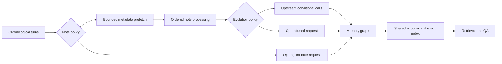
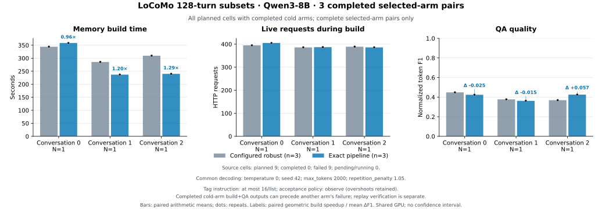

# A-Mem-Fast

A measured performance engineering project built on [A-Mem](https://github.com/WujiangXu/A-mem). It provides a bounded ingestion pipeline, an incremental exact vector index, a persistent response cache, and opt-in fused/joint memory policies. The benchmark harness separates live inference, response replay, and index microbenchmarks so their speedups can be assessed independently. Recorded LoCoMo ablations reduced answer prompt tokens by 36.98% across three fixed graphs and build requests from 206 to 64 in a one-conversation joint-note pilot.

The reference implementation is the upstream **robust** memory layer at commit `0c8039f28fdcc08189a23c07a3437d9d2482f9c2`. The upstream source files and prompts remain in the repository. The fast implementation follows the upstream successful execution path with stricter error propagation; fused evolution, joint note construction and context deduplication are explicit policy changes. See [engineering details](README_FAST.md), [source audit](docs/audit.md), and [current experiment report](docs/experiments_v2.md).



| Component | Purpose | Semantic boundary |
| --- | --- | --- |
| Rolling metadata prefetch | Overlap independent analysis with ordered graph updates | Default retains upstream prompts and mutation order |
| Exact incremental index | Reuse encoder, grow vector storage, batch changed documents at consolidation | Retains cosine ranking, row indices, consolidation schedule and stale-vector behavior |
| SQLite WAL response cache | Reuse complete request identities and audit replay | Includes model revision, endpoint and decoding settings in identity; HTTP failures and truncated outputs are rejected |
| Fused evolution | Replace conditional decision/strengthen/update requests with one structured request | Changes prompts and potentially memory/QA outcomes; opt-in |
| Joint note construction | Combine metadata and evolution in one ordered request | Changes conditioning and retrieval inputs; experimental opt-in |
| Context deduplication | Remove duplicate graph rows from QA context | Changes QA prompts; separate opt-in ablation |

## Evidence and limits

Real Qwen3-8B / MiniLM / LoCoMo runs retain successful outputs and failed attempts. All **21 completed cold arms** across the primary, held-out and full-conversation runs passed strict zero-HTTP replay of graph traces, logical request sequences and selected QA outputs. Reference-cache → exact replay checks default-path implementation equivalence on fixed responses. Fused/joint own-cache replay checks reproducibility of each changed policy, not equivalence to the reference. Independently inferred live outputs can differ.

| Experiment | Measured result | Scope |
| --- | --- | --- |
| Fixed-graph context deduplication | **36.98% fewer answer prompt tokens**, **1.420×** answer-stage speed, F1 **0.412 → 0.420** | Three fixed graphs, 36 unique questions; separate shared-GPU ablation |
| Default ordered pipeline, 128 turns | **1.143×** build speed, F1 **0.398 → 0.404** | Three completed, reference-first conversation pairs; shared GPU |
| Allocation-stable sensitivity | **1.075×** build speed, F1 **0.413 → 0.393** | Two pairs; excludes one conversation crossing a GPU memory transition |
| Full-conversation scale check | **419 turns, four consolidations**, exact graph/request/48-QA replay matched | One completed exact arm; reference failed during QA, so no paired speed claim |

Build speed uses equal-conversation geometric means of paired ratios. Context timing includes retrieval, rendering, answer generation, scoring and cache access, and excludes memory construction and query-keyword generation. Answer prompt tokens were 242,979 → 153,120 across the same 36 questions. The allocation check detects GPU memory transitions, not all competing compute load; the context phase has no dedicated GPU trace.



A separate held-out 64-turn pilot planned two conversations × two repeats with four policies. These rows use comparison-specific completed reference/candidate pairs; build request/output-token means use those same pairs.

| Candidate | Pairs / conversations / unique QA | Build speed | Build HTTP | Build output tokens | Token F1 |
| --- | --- | --- | --- | --- | --- |
| Exact pipeline | 3 / 2 / 31 | **1.383×** | 198.5 → 194.25 | 13,636 → 11,439.75 | 0.445 → 0.437 |
| Fused evolution + schema | 2 / 1 / 14 | **1.970×** | 206 → 127 | 17,199 → 11,056 | 0.547 → 0.579 |
| Joint note + schema | 2 / 1 / 14 | **2.301×** | 206 → 64 | 17,199 → 7,250 | 0.547 → 0.610 |

The pilot attempted all four cells: two completed and two failed during joint QA keyword generation after successful memory builds. Of 16 planned cold arms, 13 were attempted, 11 completed, two failed and three were not reached. Fused/joint paired results therefore cover **one conversation and two repeats of the same 14 questions**. These policies change graph decisions and output tokens as well as call counts; the observed times are not pure RPC-fusion effects. All pilot cells met the GPU allocation criterion, while shared compute remained uncontrolled. The model and fixed schemas were prewarmed.


[Detailed paired metrics](results/joint64-heldout-structured-v1-20261018/paired_metrics.md), [all-four-policy figure](results/joint64-heldout-structured-v1-20261018/four_arm_pairs.svg), and [arm-wise completion tables](results/joint64-heldout-structured-v1-20261018/derived.json) retain the full denominator. The preregistered 128-turn extension was **not executed** because its [conservative timing projection](results/joint128-heldout-structured-v1-20261018/scheduling_decision.json) exceeded the time available after the release reserve.

The original 128-turn primary attempted all nine planned three-arm cells; every optional unstructured fused arm failed JSON/domain validation. Three reference and six exact arms completed, leaving the three reference-first default pairs above. Their completed subset is not counterbalanced. Structured output guidance is an opt-in policy variant; it does not guarantee successful free-form QA or general reliability.

See the [current experiment report](docs/experiments_v2.md), [technical analysis](docs/deep_analysis.md), and [measurement index](results/README.md) for per-question outputs, quality comparisons, source snapshots and preserved failures. Repeated questions do not increase the independent sample count. These small, completion-conditional subsets do not establish a general speed or accuracy guarantee or reproduce the paper's full evaluation. [Earlier 64-turn results](docs/experiments.md) and index-only microbenchmarks remain separate from current live inference evidence.

## Install

Python 3.12 is the tested environment. The package metadata allows Python 3.10–3.13, but those versions have not been benchmarked. A CPU embedding client and a separate GPU inference environment keep benchmark resource use explicit.

```bash
# From a checkout of this repository. Requires uv; refuses an existing target.
scripts/setup_environment.sh

# Optional editable package installation in that client environment.
uv pip install --python .venv-client/bin/python -e '.[test]'
export NLTK_DATA="$PWD/.cache/nltk_data"
export OMP_NUM_THREADS=4 MKL_NUM_THREADS=4 OPENBLAS_NUM_THREADS=4
export TOKENIZERS_PARALLELISM=false
```

The setup script installs [pinned client dependencies](requirements-fast.txt), CPU PyTorch, NLTK resources, and the pinned `all-MiniLM-L6-v2` snapshot. It prints the embedding model directory; use it as `EMBEDDING_MODEL` below. For an existing environment, `python -m pip install -e '.[test]'` installs the package; download embedding/NLTK assets separately.

A compatible OpenAI-style inference endpoint is required for live benchmarks. The provided local Qwen server setup is:

```bash
uv venv --python 3.12 .venv-serve
uv pip install --python .venv-serve/bin/python vllm==0.11.2 transformers==4.57.6
INFERENCE_ENV="$PWD/.venv-serve" MODEL_DIR=/path/to/Qwen3-8B GPU_ID=0 \
  scripts/serve_qwen.sh
```

Download model weights before starting the server. The script binds to `127.0.0.1:21014` and enables the vLLM development prefix-cache reset endpoint used to isolate cold arms. GPU memory limits and other server options are configurable through environment variables in [the script](scripts/serve_qwen.sh).

## Run

Inspect coverage and the default paired order without loading models or contacting a server:

```bash
python scripts/benchmark_suite.py --plan-only \
  --samples 0 1 2 --turns 128 --repeats 2 --max-questions 12 \
  --max-tokens 2000 --repetition-penalty 1.05 --tag-budget 16 --tag-budget-policy observe \
  --output results/my-plan
```

Run an isolated configured reference / exact pipeline comparison with strict replay:

```bash
export EMBEDDING_MODEL=/path/to/all-MiniLM-L6-v2
# A stable identity for the actual weights, tokenizer, chat template and serving configuration.
export MODEL_REVISION=your-model-and-template-revision

.venv-client/bin/python scripts/benchmark.py \
  --embedding-model "$EMBEDDING_MODEL" --model-revision "$MODEL_REVISION" \
  --max-turns 64 --max-questions 12 \
  --max-tokens 2000 --repetition-penalty 1.05 --tag-budget 16 --tag-budget-policy observe \
  --modes baseline,optimized,replay,warm \
  --output results/my-smoke
```

Run the repeated suite:

```bash
.venv-client/bin/python scripts/benchmark_suite.py \
  --embedding-model "$EMBEDDING_MODEL" --model-revision "$MODEL_REVISION" \
  --samples 0 1 2 --turns 128 --repeats 2 --max-questions 12 \
  --max-tokens 2000 --repetition-penalty 1.05 --tag-budget 16 --tag-budget-policy observe \
  --continue-on-error --output results/my-suite
```

For experimental fused/joint comparisons, enable schema-guided JSON output explicitly:

```bash
.venv-client/bin/python scripts/benchmark_suite.py \
  --embedding-model "$EMBEDDING_MODEL" --model-revision "$MODEL_REVISION" \
  --samples 3 4 --turns 64 --repeats 2 --max-questions 24 \
  --max-tokens 2000 --repetition-penalty 1.05 --tag-budget 16 --tag-budget-policy observe \
  --include-fused --include-joint --structured-policy-outputs \
  --continue-on-error --output results/my-policy-pilot
```

This requires an endpoint supporting standard `response_format` JSON schemas. The flag guides only fused/joint stages; reference, upstream-policy and QA payloads remain unchanged. Schema guidance does not replace candidate-ID, branch or graph-update validation. The default path needs no schema backend. See [the API examples](README_FAST.md) for library use.

These commands use the explicit `observed-tags-v1` profile: deterministic decoding, repetition penalty 1.05, and a common system instruction requesting tag lists of at most 16 items. Oversized complete lists are recorded without clipping; malformed HTTP responses and truncation remain errors. This changes the generator contract equally for configured arms and is separate from the untouched upstream prompts. [Protocol history and failed attempts](results/README.md#preserved-failures-and-diagnostics) remain available for review. Omitting the optional flags preserves historical request identities.

The suite attempts each planned cell once. `--continue-on-error` preserves and counts generation/execution failures while attempting remaining independent cells; source, configuration and replay integrity failures stop the suite. Timing/QA comparisons use completed baseline/candidate arm pairs, including pairs in a cell where another optional arm later failed. Completion and replay verification are reported separately, and the full planned denominator remains in `suite.json`.

Use a fresh output directory for each cold run. `--resume` skips completed suite cells only when source and configuration hashes match; partial failed cells are preserved for inspection and require a new suite output. `--context-policy deduplicated` changes QA context for fast arms; the default is `upstream`. If a server does not support prefix-cache reset, `--prefix-cache-reset off` runs with that limitation recorded in the manifest.

Every subset keeps chronological turns and selects QA whose nonempty evidence references are fully contained in those turns. Categories 1–4 are selected in round-robin order; category 5 is excluded. Metrics are normalized exact match and multiset token F1, defined in the harness. `summary.json` separates build and QA times. Model loading/startup/warmup and the reference's write-only recording flush are excluded from live timings and reported separately; real inference and fast-cache overhead are included.

Response-cache SQLite files stay local and are excluded from git; the repository includes reports and source fingerprints. After a run has exited, `python scripts/archive_replay_cache.py --run-dir results/my-suite` creates a consistent private cache archive with SHA256 checks under `.private/artifacts/`.

Existing default-path outputs can be replayed with the same benchmark configuration and `--modes replay,warm`. Replay is strict, never falls back to inference, and needs no live server. A changed model or template requires a new revision identity.

## Test and inspect

```bash
.venv-client/bin/python -m pytest -q
.venv-client/bin/python scripts/benchmark_index.py \
  --embedding-model "$EMBEDDING_MODEL" --output results/my-index.json
```

Saved suites can be summarized and plotted without running inference:

```bash
python scripts/summarize_suite.py results/my-suite/suite.json --output results/my-suite/derived.json
uv venv --python 3.12 .venv-analysis
uv pip install --python .venv-analysis/bin/python 'matplotlib>=3.8,<3.11'
.venv-analysis/bin/python scripts/plot_suite.py results/my-suite/suite.json \
  --output results/my-suite/overview.svg --png
```

The figure includes individual repeat dots and saves the plotted data with a source-suite hash. Unit tests use deterministic HTTP and embedding doubles; they do not download models or contact a live service. They cover graph/request/QA replay equivalence, rolling prefetch, failures, parser validation, exact ranking and ties, index rebuilds, cache isolation and concurrent request coalescing. The index microbenchmark uses real MiniLM embeddings and LoCoMo text, and measures index work only.

## Attribution

The original A-Mem README, paper links and citation are preserved in [docs/UPSTREAM_README.md](docs/UPSTREAM_README.md). Original code copyright and MIT terms remain in [LICENSE](LICENSE); [NOTICE](NOTICE) records provenance and the scope of this engineering work. The dataset and original figures are inherited from upstream. LoCoMo data is separately licensed under [CC BY-NC 4.0](data/LICENSE-LOCOMO.txt); see [dataset attribution](data/README.md). No upstream paper results are claimed as results of A-Mem-Fast.
