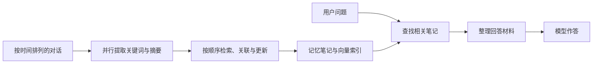
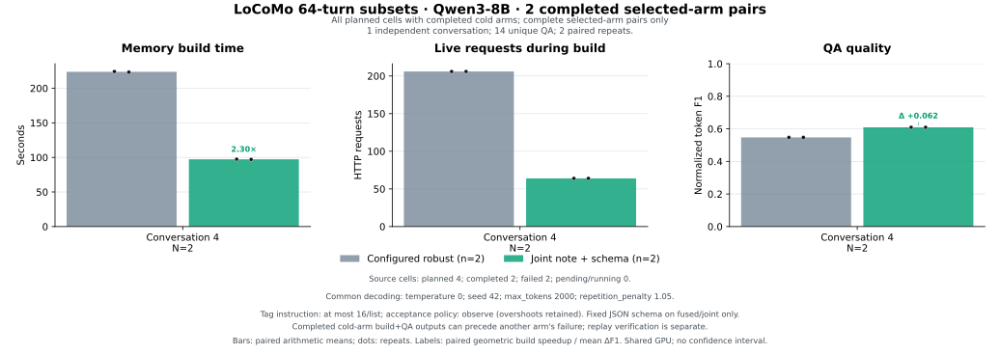

# A-Mem-Fast

让 A-Mem 更快地整理长对话记忆。

[A-Mem](https://github.com/WujiangXu/A-mem) 会把对话整理成笔记，提炼关键词、连接相关记录，并根据新信息更新旧笔记。处理一条记录时，这些步骤可能连续调用多次大模型。A-Mem-Fast 从这条调用链入手，提前处理独立任务，减少重复编码，并提供一次调用完成记忆整理的可选方案。

## 实现

- **提前准备，按顺序更新。** 并行提取后续记录的关键词和摘要，检索与记忆更新仍按对话顺序执行。线程数和预取数量均可设置。
- **复用编码结果。** 多条记录共享文本编码器；向量存储按容量扩展，定期重建时只重新编码变化的文本。
- **合并模型任务。** `fused` 将记忆关联与更新合成一次请求；`joint` 进一步加入关键词和摘要提取，每条记忆用一次请求完成。两种方案都支持 JSON 结构约束。
- **缩短回答材料。** 按记忆编号去掉重复条目，保留首次出现的顺序。
- **记录与回放。** 用 SQLite 保存模型响应；固定回答后逐条比较记忆状态、请求和问答输出，帮助定位实现差异。

默认实现沿用上游的提示词和更新顺序。`fused`、`joint` 和回答材料去重均为可选项，可分别比较速度与回答质量。



## 实测结果

使用 Qwen3-8B、MiniLM 和 LoCoMo 对话数据，分别测量记忆构建、回答材料去重和索引重建。

| 改进 | 结果 | 测量范围 |
| --- | --- | --- |
| 联合记忆整理 `joint` | 构建约 **224 → 97 秒（2.30×）**，请求 **206 → 64 次** | 一个会话的 64 条记忆，两次完成配对 |
| 回答材料去重 | 答案输入 tokens **减少 36.98%** | 三个固定记忆图，36 道不同问题 |
| 默认并行流程 | 构建 **1.14×** | 三个会话，各 128 条记忆的完成配对 |
| 批量索引重建 | 重建 **2.52×** | 1,024 文档，真实 MiniLM 编码器 |

联合策略实验共安排两个会话、各重复两次。四次记忆构建均完成，其中一个会话的两次后续关键词生成失败；表中的 2.30× 来自另一个会话的完整配对。该子集共 14 道问题，平均 F1 从 0.547 提高到 0.610，逐题结果为 2 道提高、1 道下降、11 道持平。

默认流程的三个完成配对均先运行原版；按 GPU 显存分配稳定性筛选后的两对构建速度为 1.08×。实验使用共享 GPU，样本量和其他计算负载会影响耗时。各项结果的比较方法、失败记录和逐题评分见[实验报告](docs/experiments_v2.md)。



固定模型响应的检查覆盖 **419 条记忆、4 次索引重建**，原处理逻辑与优化实现的逐步状态和请求一致。优化实现自身的 **48 道问答回放**也与原运行一致。项目另有 [281 项自动测试记录](results/clean-client-validation-final.json)。

## 开始使用

已测试环境：Python 3.12。客户端使用 CPU 编码文本，大模型通过兼容 OpenAI API 的服务调用。

安装 [uv](https://docs.astral.sh/uv/) 后，在仓库根目录执行：

```bash
scripts/setup_environment.sh
uv pip install --python .venv-client/bin/python -e '.[test]'
export NLTK_DATA="$PWD/.cache/nltk_data"
```

安装脚本创建 `.venv-client`，准备依赖、NLTK 资源和固定版本的 MiniLM，并输出模型目录。可先查看实验计划，了解样本和运行顺序：

```bash
.venv-client/bin/python scripts/benchmark_suite.py --plan-only \
  --samples 0 1 2 --turns 128 --repeats 2 --max-questions 12 \
  --max-tokens 2000 --repetition-penalty 1.05 \
  --tag-budget 16 --tag-budget-policy observe \
  --output results/my-plan
```

配置模型服务并运行实验，请看[使用指南](README_FAST.md)。其中包括本地 Qwen 服务、Python 接口、策略选择和响应回放。

运行自动测试：

```bash
.venv-client/bin/python -m pytest -q
```

测试使用模拟模型响应和文本向量，可在 CPU 环境运行。

## 仓库结构

| 路径 | 内容 |
| --- | --- |
| [fast_amem/](fast_amem/) | 并行处理、记忆策略、向量检索与响应缓存 |
| [scripts/](scripts/) | 环境安装、模型服务、实验和绘图脚本 |
| [tests/](tests/) | 调度、检索、解析、缓存、回放与异常处理测试 |
| [docs/](docs/README.md) | 性能分析、实现说明与实验方法 |
| [results/](results/README.md) | 测量结果、图表和逐题记录 |
| [data/](data/README.md) | LoCoMo 数据及来源说明 |

## 来源与许可

项目基于 A-Mem 的 `robust` 实现，参考提交为 `0c8039f28fdcc08189a23c07a3437d9d2482f9c2`。[上游 README](docs/UPSTREAM_README.md) 保留了论文、原始项目介绍和引用方式。

代码使用 [MIT 许可证](LICENSE)，项目来源见 [NOTICE](NOTICE)。LoCoMo 数据使用 [CC BY-NC 4.0](data/LICENSE-LOCOMO.txt)，相关说明见[数据目录](data/README.md)。
