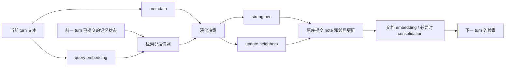

# A-Mem 为什么慢，以及下一步应该优化什么

本文分析固定上游 `0c8039f28fdcc08189a23c07a3437d9d2482f9c2` 的 robust 路径。历史数据来自 [64-turn 最终基线](../results/locomo64-final/baseline.json)，新增的缓存内容审计来自 [派生证据](deep_analysis_evidence.json)。它解释实现和实验设计，不把推导当作新的实测结果。新的多 conversation 对照结果另见实验报告。

## 1. 当前主要付费项是连续生成，不是向量数据库

64 条记忆的基线构建耗时 280.839 秒，其中 HTTP 等待累计 278.005 秒，占 99.0%。这一基线逐条执行，因此请求耗时之和可以用于判断串行占比；并发优化组不能照此相加。

| 构建步骤 | 请求数 | 入口累计耗时 | 构建时间占比 | 输出 tokens |
| --- | ---: | ---: | ---: | ---: |
| 当前文本 metadata | 64 | 70.172 s | 24.99% | 2,679 |
| evolution decision | 63 | 117.913 s | 41.99% | 4,220 |
| strengthen | 63 | 64.460 s | 22.95% | 2,197 |
| update neighbors | 3 | 25.476 s | 9.07% | 964 |

63 次 decision 的结果为 60 次 `STRENGTHEN`、3 次 `STRENGTHEN_AND_UPDATE`。这批数据上，decision 门控没有省掉任何 strengthen 调用，却消耗了约 42% 的构建时间和 42% 的构建输出 tokens。输出还包含程序不使用的 `REASON`，平均每次 decision 共 67 tokens。不能据此断言所有数据都不需要决策，但它说明该子集里优化这个步骤比替换向量数据库更有针对性。

上游 update 要求把所有候选邻居的 context/tags 全部写回，即使没有变化也重述原值。3 次请求已经花费 25.5 秒。减少 HTTP 次数和减少生成文本是两件事：把三次请求简单合并成一个要求长篇重述的请求，仍可能被长输出拖慢。

这里没有 token-level 服务端时间分解，不能把全部 HTTP 时间都称为 decode 时间。网络、排队、prefill 和 decode 都在其中。能直接证明的是 LLM 请求路径占主导，以及输出和重复输入存在具体压缩机会。

后续 pilot 还暴露出平均耗时会掩盖的长尾：第 116 条的 strengthen 触及 1000-token 上限而被 strict client 拒绝。原截断正文没有保留，但用完全重建的同一 prompt 单独改成 2000-token 上限后，仍以 `finish_reason=length` 结束，生成 15,001 字符的 tags 文本，其中空白切分的 `Transformational` 出现 683 次。该请求耗时 23.88 秒，见 [单请求诊断](../results/diagnostics/strengthen_cap2000.json)。这是本机 Qwen3-8B、temperature=0 的 configured-robust 实验所观察到的重复生成，不能外推成上游 temperature=0.7 默认行为或所有 A-Mem 模型的必然缺陷。tags 提示词缺少长度上限提供了失控空间，greedy 配置下的重复则是本次实证症状；没有解码消融，不能进一步断言具体因果机制。不能把预算翻倍当作修复，也不能静默截取前几个 tags 后宣称成功。它提醒我们区分“正常必需的调用链”与“格式失控导致的生成长尾”。

## 2. 数据依赖决定可并行的范围

metadata 只读当前文本，可以提前执行；query embedding 也只读文本，可以提前编码。候选检索读取演化后的历史状态，必须等待前一条提交。最终文档的 tags 可能被 strengthen 改变，所以不能直接把所有最终文档在开头一次编码。任意并发调用整个 `add_note()` 会改变可见历史、邻居和写入顺序。

当前代码中，decision 之后的 strengthen 与 update 请求使用相同的旧邻居快照；update prompt 不读取 strengthen 新生成的 tags/links。所以在成功路径上，这两个请求具备并行条件，只需按既定顺序应用结果。不过历史基线仅有 3/63 条需要 update，收益有限；错误时是否保留部分更新也必须明确。严格失败和事务式提交是更合理的工程约定，但它与上游吞掉异常后继续存储的行为有区别。

假设其他步骤耗时不变，且能够完全隐藏 metadata：

`280.839 / (280.839 - 70.172) = 1.333×`

这是基于该次计时的理想化估算，不是硬件无关上限。它解释了为什么只做 metadata 预取，观测到约 1.3× 并不意外。真实调度中，metadata 也占 GPU 时间，会挤占演化吞吐；共享负载变化又可能让观测超过或低于该估算。把线程数从 4 调到 32 并不能推导出 8 倍收益。

有界滚动预取比“每 16 条提交一批，再等下一批”更容易消除窗口边界等待。提交完一条后补充下一条分析任务，使待处理数量始终有上限。它改善调度，不减少首次分析次数，也不突破剩余演化依赖。query embedding 批量预取也属于这个层次；CPU embedding 本来只占很小比例，应先保证数值与排序可核对，再讨论收益。

## 3. 真正减少冷输入调用：把演化作为一个明确的策略选项

本项目区分两条路线：

| 路线 | 目的 | 必须接受的验证方式 |
| --- | --- | --- |
| 保持上游请求/状态的工程优化 | 调度、索引、缓存、重建更高效 | baseline 响应严格重放后，逐步状态、请求键和 QA 一致 |
| `fused` 演化策略 | 一次输出决策、连接、tags 和邻居变更 | 独立实时质量/速度对照，策略自身重放；不能要求与原提示词逐字等价 |

单次演化接口可以只生成必要 JSON：决策、新 note 的连接和 tags、确实变化的邻居列表。连接与更新都引用明确的全局行号，只接受本次检索出的邻居；先校验完整结果，再修改记忆。无需 free-form reason，无变化的邻居不要求重新生成原文。对不允许的字段组合、重复更新目标、越界 ID、截断输出明确报错，避免靠异常吞掉实现“快速完成”。

在没有重试和额外关键词补救的情况下，一条 metadata 加一条 fused evolution，使 N 条记忆共 `2N-1` 次构建逻辑调用；若请求全部不同且未缓存，才对应相同数量的 HTTP 请求。这批 64 条历史基线的 193 次对应理论结构变为 127 次，减少 66 次，即 34.2%。**这是调用结构推导，实际次数和时延必须以新的运行结果为准。** 少调用不保证同比例少时间，尤其需要记录 fused 输出长度、update 触发率、解析失败和 QA 质量。

这不是纯粹的“把三个 RPC 合成一个”。它同时改变了提示词、输出形式、邻居更新的稀疏表示和 ID 约束。若整体效果良好，可以作为一个完整策略报告；若要归因于某个设计，应继续拆分为“相同字段合并”“去除 reason”“稀疏更新”“ID 修复”等消融。原论文也把 note construction、link generation、memory evolution 分别描述；这里是对当前 robust 实现的工程研究，不是提出这些记忆能力本身。[A-Mem 论文，第 3 节](https://arxiv.org/html/2502.12110v11#S3)

另一个可研究方向是廉价规则或小模型决定是否值得演化。但历史子集里几乎每条都 strengthen，并不构成“可以安全跳过”的证据。跳过策略需要对新事实、矛盾信息和跨会话关联单独检查召回，不应仅用平均速度决定阈值。

更进一步，当前上游用原始 `note.content` 检索候选，检索本身并不依赖刚生成的 metadata。因此可以先查邻居，再用一次联合请求生成 metadata、连接和邻居更新，理论上降到每条一请求。代价是失去独立 metadata 的并发分支，改变了生成条件，而且单次输出更长；不能从 `2N-1 → N` 推导时延减半。它适合作为后续独立策略，当前 fused 仍保留 metadata 预取，不能把联合构建的预期收益计入当前结果。

## 4. QA 还有一个独立问题：重复邻居和 ID 歧义

对历史最终基线的原始响应做只读审计：63 次 strengthen 共输出 186 个连接，其中 3 个不在该次提供的候选邻居中。例如候选全局行号是 `[0, 3, 5, 7, 11]`，响应却是提示词示例里的 `[0, 2, 3]`。这证明候选约束被违反；不能仅凭这个例子断言模型一定把局部 ID 当成了全局 ID。原代码直接将这些数字用于全局数组，可能静默连接到无关但合法的旧行。证据中的请求键、候选与原始响应可逐条检查。

12 个 QA 上下文合计渲染 473 次记忆，但去掉完全相同的序列化条目后只剩 281 次，重复比例约 40.6%。按第一次出现顺序做文本去重的离线估算，context 从 272,034 字符变为 161,805 字符，减少约 40.5%。这是字符量的后处理分析，没有调用新模型，不等于测得 token、时间或质量提升。完整统计和提取方法在 [证据 JSON](deep_analysis_evidence.json)。本地原始 SQLite 缓存未随仓库发布，该 JSON 是派生证据而非完整响应存档。

正式实现宜按稳定 memory ID 去重，而非按文本去重，因为文本相同的不同时间事件仍可能有意义。保留主检索排序和首次出现顺序，记录原始/唯一条目数、prompt tokens、答案变化；限制连接展开数量、强制 token budget 则分别作为其他策略。即使重复内容被删掉，模型的注意力和答案仍可能变化，因此去重也不是严格提示词等价优化。

## 5. 小规模无感的索引问题，会在长记忆里累积

上游逐次 `vstack` 为 N 次插入搬运约 `N(N-1)/2` 个旧向量，代价为 `O(N²d)`；几何扩容把追加的累计旧数据搬运降到 `O(Nd)`。每个 turn 精确检索历史向量仍要 `O(nd)`，全构建累计仍有 `O(N²d)` 的相似度计算。精确索引并没有把整个构建变成线性算法。

每 H 次有效演化重新编码全库，最坏情况下的累计文档编码量近似：

`H + 2H + … + floor(N/H)H ≈ N²/(2H)`

还不包括每条新 note 的初始编码。当 N=10,000、H=100 且每条均触发演化时，这是约 50.5 万次重建文档编码，而不是一万次。这是复杂度示例，不是实测。复用 encoder、批处理、只编码文本改变的行可显著降低这一部分；批处理本身只是改变调用批次，只有文本复用才减少需要编码的内容。Sentence Transformers 官方接口支持批量编码，并建议按硬件、输入长度测试 batch size。[Sentence Transformers 文档](https://sbert.net/docs/package_reference/sentence_transformer/model.html#sentence_transformers.SentenceTransformer.encode)

当前精确方案必须保留上游的刷新时点：邻居 metadata 变化后，其旧向量暂时仍用于检索，直到 consolidation。立即更新向量可能更符合用户直觉，但会改变下一条的候选和后续所有请求。改为稳定文档格式也有同样风险，因为上游插入格式与 consolidation 格式不同。它们应作为单独策略，而不是悄悄加入性能补丁。

数值类型也是等价边界。若文档以 float32 预先归一化，而后续 query 突然输出 float64，上游 sklearn 可能先统一提升精度再归一化，优化路径却已经保存了 float32 舍入后的结果；极近分数可能交换排序。因此“精确 cosine”不能解释为对任意混合 dtype 都与上游位级相同。当前真实实验固定 MiniLM 的 float32 输出；通用接口应固定 encoder 的输出 dtype 并对变化明确报错，不能静默降精度或以近似结果替代。即使 dtype 一致，已有测试与重放提供的也是指定输入范围内的数值验证。

当精确搜索、存储量或大量并发查询确实成为瓶颈时，再比较 ANN 的延迟、内存和 recall@k。不能拿 ANN 单次 top-k 的加速比代替整条记忆处理速度，也不能把精确 top-k 一致性换成近似召回后继续宣称结果等价。本文的向量复杂度分析依据本仓库代码；论文的 retrieval scaling 表也不能直接解释含 LLM 构建与问答的总运行时间。[A-Mem 论文，第 4.6 节](https://arxiv.org/html/2502.12110v11#S4.SS6)

## 6. 超出单 conversation：吞吐和在线延迟要分开设计

**跨 conversation 调度。** 不同用户或 conversation 的记忆状态互不依赖时，可以同时处理各自下一条 turn，让多个串行链共同占满推理服务。每个 conversation 保持一个有序写入通道，metadata 使用全局有界队列，并限制每个 conversation 的在途请求。它可能提高单位时间完成的 conversation 数，却不一定降低某个用户的单条延迟。比较算法时，基线也应获得相同的多 conversation 并发机会，避免把服务利用率差异记成算法优势。

**批量 metadata。** 把若干独立分析放入一个 prompt 可以减少请求固定开销，但会引入样本间相互影响、ID 对齐、某一项截断导致整批失败等问题。它不是当前“多请求并发”的等价替代。服务端 continuous batching 与应用层把多文本合成一个 prompt 也不是同一个机制。

**异步或延迟演化。** 在线聊天可能更需要快速确认“已记住”，而不是立即完成所有关系重写。可以先持久化原始 note 和基础向量，后台在固定快照上补充链接/演化；读取时同时检索已提交视图与待处理原始事件。这样需要明确可见版本、read-your-writes、更新冲突、重放幂等和 backlog 上限。返回确认的延迟下降，不等于总工作减少；评测必须同时报告初始可用时间、后台完成时间及未完成演化时的回答质量。该方案改变在线一致性约定，当前仓库没有把它包装成已经实现的功能。

**模型分工。** metadata/格式化可以尝试更小模型，演化留给较强模型；也可按困难样本路由。模型、tokenizer、模板与生成参数必须进入缓存身份，两模型的质量/延迟联合评估后再决定。单纯换更小模型所得收益不能记为索引或调度优化。

## 7. 服务优化有帮助，但解决不了应用层多余步骤

前缀缓存复用的是相同前缀的 prefill，不会消除新输出 token 的生成。上游各步骤的指令不同，动态新 note 又位于邻居块前面，同一邻居集合被重复发送也不代表它能直接共享全部 KV。调整 prompt 排列以提高前缀复用值得实验，但会改变模型输入；需要与其他提示词策略分开。[vLLM 0.11.2 APC 文档](https://docs.vllm.ai/en/v0.11.2/features/automatic_prefix_caching/)

固定 temperature 和 seed 也不代表不同并发调度必然逐字一致。本项目已有相同请求键返回不同正文的记录；具体数值机制尚未单独定位。vLLM 0.11.2 的 batch-invariance 功能要求 compute capability ≥9.0，不能假定它适用于当前 A100 环境。[vLLM 0.11.2 batch invariance 文档](https://docs.vllm.ai/en/v0.11.2/features/batch_invariance/)

针对已复现的重复 tags，可以预先固定较小的 `repetition_penalty`，先用失败输入和正常格式控制样本做诊断，再决定是否建立新的共同推理配置。vLLM 的该参数作用于 prompt 和已生成文本中出现的 token，因此可能影响正常内容、字段名和数字，不能称作语义中性修复。若采用，必须对所有对照组一致应用并进入请求缓存身份；诊断只检查停止和格式，不根据末端 QA 分数搜索参数。[vLLM 0.11.2 SamplingParams](https://docs.vllm.ai/en/v0.11.2/api/vllm/sampling_params/#vllm.sampling_params.SamplingParams.repetition_penalty)

因此，响应重放是工程验证工具：固定外部模型结果，检查调度和索引是否改变了记忆语义。它不能替代实时质量评测，也不能拿零 HTTP 的 replay 时间冒充真实推理速度。缓存还冻结了某次模型输出，而不是证明服务对该请求永远确定。

缓存成功与策略成功也要分开。client 可以判断 HTTP 错误、缺少文本或 token 截断，但 fused/joint 的领域 schema 在收到文本后才校验。HTTP 成功而 JSON/引用不合法的响应可能已进入缓存，策略仍会明确失败；相同缓存下再试会复现失败，不能称为自动修复。声称“失败响应不入库”时应明确指 client 检测到的失败，不能扩展成所有下游语义错误都不会缓存。

## 8. 怎样让新实验能支持项目结论

1. 保留历史两轮结果，新的结果使用独立目录、源码哈希和完整配置。区分模型已加载的空响应缓存、请求缓存热运行、固定响应重放和索引微测。
2. 先固定 conversation、截断长度、QA 选取及排除规则，之后再运行；保留 QA 原始索引。所有 evidence 都在截断范围内是必要条件，但不能保证不存在额外隐含依赖。开放领域问题还可能需要外部知识。
3. 使用多个 conversation 和重复运行，平衡先后次序；三组时循环轮换位置。重置跨组 prefix cache 并监控 GPU 占用。共享资源下只能报告该环境的观测，轮换不能消除全部混杂。
4. 冷实验同时记录时延、HTTP 数、输入/输出 tokens、实际演化分支、解析错误、截断和 QA；不要因一次失败就忽略那个运行或只留下最好的一次。
5. 基线与 exact 路线做逐步状态、原序请求键、完整 QA 的严格重放；fused 与自身录制结果重放。失败必须可见。重放通过的范围是固定输入和固定响应，不是对任意数值边界的数学证明。
6. 报告每个 conversation 的质量变化和速度比，再汇总。多个题目共享同一记忆构建，多个重复运行共享同一题集，不能把它们当作彼此独立的上百个样本推导高置信度。小样本优先展示原始分布、均值/中位数和范围。
7. 对 fused 的请求数优势做结构归因，对时延/质量做实测归因；对去重报告 tokens 和质量变化。若二者一起改，先称组合策略结果，避免宣称单项设计独立贡献。

建议项目对外重点展示可检查的贡献：定位串行临界路径；有界预取和变化感知索引；持久缓存与失败可见性；严格重放；以及经多次实测支持的策略效率。某一配置若速度提高但质量下降，可以作为明确的取舍保留。是否成为推荐配置，应由同一预设协议的结果决定。

## 9. 联合构建的后续试验设计（尚不是结果）

在查看联合策略的模型输出之前，建议先固定以下试验：选择主实验之外的 sample 3 (`conv-42`) 与 sample 4 (`conv-43`)，每个取 64 turns 和最多 24 道证据完整 QA，实际分别有 17、14 题。每个 conversation 重复两次；baseline、exact、fused、joint 四组都在同一轮重新实时运行，轮换/反转顺序，每组重置前缀缓存。不能直接用数小时前主实验的 baseline 时间充当新 joint 的配对对照。

joint 接口分为 `metadata` 和 `evolution` 两个嵌套对象，先校验全部字段与全局 ID，再构造 note 和提交更新。首条无邻居时必须不演化；构造器接收完整 metadata/category，避免隐式再调用分析。joint 的 ingest 不启动 metadata 预取，记录 `joint_note` 阶段，按逻辑一条输入一次请求，另列重试与缓存命中。它可以复用工程基础设施，但必须单独测试自己的响应重放。

优先比较 joint/fused 的配对构建与 build+QA 时延、输入/输出 tokens、失败率和逐题答案；同时保留 baseline/exact 便于解释质量。31 道独立题目、两个 conversation 的 pilot 只用于判断是否值得继续，不足以证明非劣效。若继续扩大，可以预设同两个 conversation 的 128-turn 版本，每个均有至少 24 道符合条件的 QA，并检查实际 consolidation 次数。任何提示词调整、配置改变或样本扩展都产生新实验身份，保留此前失败与结果。

## 10. 新实验首轮发现的资源切换及处理原则

128-turn 三组 suite 的首个 cell 中，baseline 构建 650.284 秒，exact 构建 235.289 秒，表面加速约 2.76×。但 GPU2 监控在本地时间 01:00:08.676 至 01:00:10.695 之间从 60,476 MiB 降至 44,481 MiB，减少 15,995 MiB。根据结果文件当时的修改时间、单列的落盘时间和 QA 时长，baseline 构建约在 01:00:07.8 结束，exact 构建则在资源下降之后开始。文件时间重建只用于定位大致阶段，不能冒充原始逐请求 wall timestamp；取证时的时间、文件哈希及原始监控前缀哈希保存在 [resource_audit.json](resource_audit.json)。

两组均执行 127 次 decision，输出分别 8,649、8,546 tokens，但其中位入口时延从 1.895 秒降到 0.918 秒；127 次 strengthen 的输出反而由 4,787 增至 4,929 tokens，中位时延仍从 1.115 秒降到 0.592 秒。这些串行阶段的近两倍加速，不能仅由 metadata 重叠解释。显存下降本身不能识别哪个进程结束，也不能严格证明计算竞争的因果关系，但足以把这个配对标为资源切换混杂，不能把 2.76× 当作纯实现收益。

处理方式是在主报告保留全部预设 cell，同时固定一个后续机械应用的敏感性口径：GPU2 整个 cell 的显存范围不超过 1,024 MiB，至少有 10 个监控样本，最大相邻采样间隔不超过 10 秒。它是在看到首轮异常后确定的敏感性规则，并非原始预注册；其名称应为“显存分配稳定子集”，不能叫“独占 GPU”或“计算负载恒定子集”。稳定显存并不排除其他进程持续竞争计算资源。所有 cell 均使用同一资源规则，不按加速比大小筛选。

敏感性报告应显示每个 conversation 保留了几次运行；若次数不等，同时给出按 conversation 等权的汇总，避免首个 conversation 因少一次而被隐式降低权重。suite 结束后、冻结源码解除前，计划追加一次 sample 0 / 128-turn 的同配置三组确认，单列为补充实验。若其与其他 8 个原始 cell 均满足资源规则，可以额外展示“平衡的显存分配稳定 9 次对照”：sample 0 的两个原始稳定重复加这一个确认，另两个 conversation 各三个原始重复。原始 9 次、补充确认以及筛选条件均保留可见，不能把这个派生集合冒充原始预设的 9 次。

若其他 cell 或确认也不满足资源规则，按实际保留数量报告，不继续反复运行直到得到好结果。每个 conversation 先汇总重复运行的 log speedup，再在 conversation 间等权求均值并取指数；F1 则先在同一 conversation 的重复运行间取平均，再对 conversation 等权平均。确认没有增加独立 conversation 或独立问题数量，也不能使重复回答同一题变成更多独立样本。
