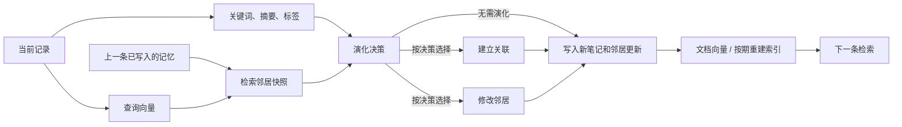

# A-Mem 为什么慢，以及下一步应该优化什么

本文中的笔记信息指关键词、摘要和标签。

本文基于上游 `0c8039f28fdcc08189a23c07a3437d9d2482f9c2` 的 robust 实现，分析长对话记忆的构建开销。主要时间花在连续等待模型和生成更新文本上。优化分为两类：保留原处理流程的调度与索引改进，以及合并模型任务的可选策略。

默认工程优化在同一批模型回答下完成 419 条记忆的逐步构建对比，覆盖四次索引重建；48 题另由优化版自身回放检查。三个固定记忆图的上下文去重实验，使 36 道问题的答案输入 tokens 减少 36.98%。各实验的速度、质量与完成情况见[实验报告](experiments_v2.md)，本文说明实现和后续方向。

| 路线 | 做了什么 | 如何检查 |
| --- | --- | --- |
| 默认工程优化 | 提前提取后续记录的信息，按序写入；复用编码器，只重算变化文本的向量 | 固定模型回答，逐条比较状态、请求和问答；编码器及其数值类型固定 |
| 可选任务合并 | fused 合并记忆更新，joint 再将新记录分析一并完成；生成时约束 JSON 格式 | 三项固定输入通过格式检查；另测完成率、耗时和回答质量 |
| 可选上下文去重 | 同一条笔记只呈现一次，保留首次出现顺序 | 三个固定图、36 道问题的输入 tokens 减少 36.98%，逐题比较答案 |
| 后续方向 | 多会话同时整理、缩短生成文本、保存可恢复的记忆状态 | 测量吞吐、用户等待、失败、质量和恢复成本 |
| 按需要评估 | 近似搜索（ANN）或较小模型 | 搜索成为瓶颈时比较候选覆盖；模型替换需检查事实和答案质量 |

历史分阶段计时来自 [64 条基线](../results/locomo64-final/baseline.json) 和 [缓存统计](deep_analysis_evidence.json)。各时期使用的配置和样本分别记录。

## 1. 主要时间花在模型请求上

64 条记忆的基线构建耗时 280.839 秒，其中 HTTP 等待累计 278.005 秒，占 99.0%。这一基线逐条执行，因此请求耗时之和可以用于判断串行占比；并发组则分别报告各请求时间和实际总耗时。

| 构建步骤 | 请求数 | 入口累计耗时 | 构建时间占比 | 输出 tokens |
| --- | ---: | ---: | ---: | ---: |
| 提取关键词、摘要和标签 | 64 | 70.172 s | 24.99% | 2,679 |
| 更新决策 | 63 | 117.913 s | 41.99% | 4,220 |
| 建立关联 | 63 | 64.460 s | 22.95% | 2,197 |
| 邻居更新 | 3 | 25.476 s | 9.07% | 964 |

63 次更新决策返回 60 次 `STRENGTHEN`、3 次 `STRENGTHEN_AND_UPDATE`，随后全部进入建立关联。更新决策占约 42% 构建时间和 42% 输出 tokens；每次平均 67 tokens，其中包含程序未使用的 `REASON`。这批输入适合进一步比较紧凑决策输出和任务合并。

上游邻居修改要求返回所有候选邻居的 context/tags，未变化的内容也会重述。3 次请求花费 25.5 秒，因此优化既要关注请求次数，也要关注生成文本长度。

HTTP 时间包括网络、排队、输入处理和生成，现有记录未将服务端各部分拆开。它足以定位模型请求占比，并找到重复输入和输出较长的步骤。

后续试运行中，第 116 条建立关联触及 1000-token 上限。原截断正文未保存；重建同一提示词并将上限改为 2000-token 后，仍以 `finish_reason=length` 结束，生成 15,001 字符，其中 `Transformational` 按空白分词出现 683 次，耗时 23.88 秒。详见 [单请求诊断](../results/diagnostics/strengthen_cap2000.json)。重复发生在本机 Qwen3-8B、temperature=0 配置下；上游默认 temperature=0.7。具体原因还需要解码对照，单纯增加输出预算未解决这次问题。

严格标签上限方案的首个 128 条原版构建耗时 344.014 秒，HTTP 等待 336.739 秒，占 97.89%。信息提取、更新决策、建立关联、邻居修改分别占 18.99%、30.32%、27.58%、21.03%。13 个邻居修改请求只占 395 个请求的 3.29%，却生成 22.83% 的输出 tokens；每次平均约 453 tokens，信息提取、更新决策、建立关联分别约 41、60、55。索引重建为 1.448 秒，占 0.42%。若其他工作固定，将信息提取的等待完全与后续工作重叠，速度约为原来的 1.234×；历史 1.333× 来自另一条计时记录。两次输入、配置和资源状态不同，分别用于分析瓶颈。详见[分阶段计时](primary_profile_audit.json)。

## 2. 数据依赖决定可并行的范围

`process_memory()` 调用 `find_related_memories(note.content, k=5)`，直接用原文检索。笔记信息和查询向量都只依赖当前文本；当前实现提前获取笔记信息，批量提前编码查询可继续研究。检索需要前一条更新完成后的记忆，最终文档编码还需等待 tags 等字段确定，因此写入保持顺序。

更新决策后的建立关联和邻居修改读取同一份旧邻居快照，具备并发请求、顺序应用结果的条件。历史基线仅 3/63 条需要邻居修改，预期空间较小。实现时还需明确一项失败后如何处理另一项结果；当前严格模式直接报告错误，上游则会捕获错误后继续。

假设其他步骤耗时不变，信息提取的等待能完全与后续工作重叠：

`280.839 / (280.839 - 70.172) = 1.333×`

这给出该次工作量固定时约 1.3× 的理想估算。提取信息也占用 GPU，服务负载和生成分支都会影响结果。增加线程后的实际收益需要测量。

滚动预取在消费一条结果后补入下一条，使至多 16 条提前任务持续推进，减少分批等待。它重叠首次分析时间，后续记忆更新仍按序执行。查询向量批量编码也可沿用这一调度，先检查数值与排名，再测量 CPU 收益。

## 3. 合并模型任务：fused 与 joint

本项目区分两条路线：

| 路线 | 目的 | 验证方式 |
| --- | --- | --- |
| 保持上游请求/状态的工程优化 | 调度、索引、缓存、重建更高效 | baseline 响应严格重放后，逐步状态、请求键和 QA 一致 |
| `fused` 演化策略 | 一次输出决策、连接、tags 和邻居变更 | 独立测量质量与速度，使用自身响应回放 |

fused 一次返回决策、新记忆连接和 tags、发生变化的邻居。连接和更新使用候选中的全局行号；程序校验全部字段、重复目标和编号后才修改记忆。输出只保留处理所需内容，省去自由描述的 reason 和未变化邻居的重述。

通常每条一次笔记信息，加一次 fused 记忆更新，首条跳过记忆更新，N 条共 `2N-1` 次逻辑调用；全部请求不同且缓存为空时，HTTP 数相同。历史 64 条基线为 193 次，对应合并后的 127 次，减少 66 次、34.2%。这描述调用结构；实际耗时还取决于输出长度、更新分支和失败情况。

fused 同时调整了提示词、输出格式、邻居更新内容和编号校验。当前测量这些改动的组合效果；后续可以分别比较合并请求、省去解释文字、只返回变化项和统一编号的作用。A-Mem 论文第 3 节介绍了笔记生成、关联建立和记忆更新，本项目研究当前 robust 实现的执行效率。[A-Mem 论文，第 3 节](https://arxiv.org/html/2502.12110v11#S3)

observed 实验首个 fused 在第 4 条失败：响应正常停止、84 tokens，但 JSON 末尾多一个 `}`。详见 [失败诊断](../results/suite128-primary-observed-v1-20261018/turns128-sample0-upstream-r1/fused-response-diagnostic.json)。响应被缓存后，程序解析仍会失败。连续处理会累积格式风险：作为算术示例，若每次独立成功率为 99%，127 次全成功约为 27.9%；若为 99.9%，约为 88.1%。这些假设用于说明长链特点，实际完成率按整次运行统计。后续实现已加入生成期 schema 约束。

规则或小模型也可判断是否值得演化。历史子集几乎每条都建立关联，因此跳过策略需要另测新事实、矛盾信息和跨会话关联的检索覆盖及 QA。

joint 进一步利用原文先检索邻居，再一次生成笔记信息、连接和邻居更新，调用结构由 `2N-1 → N`。代价是改变笔记信息的生成条件、取消独立预取，并增加单次输出内容。它已作为独立策略实现和测量，结果见文末。

joint 返回 `metadata` 和 `evolution` 两个对象，全部校验后构造笔记并提交更新。邻居为空时选择独立存储。构造笔记时直接传入关键词、摘要、标签和 `category`，避免再次分析。`ingest` 顺序执行，记录 `joint_note` 阶段；通常每条输入一次调用，重试和缓存命中单列。

## 4. 重复上下文与邻居编号

历史基线的 63 次建立关联输出 186 个连接，其中 3 个未出现在当次候选中。例如候选为 `[0, 3, 5, 7, 11]`，响应为示例中的 `[0, 2, 3]`。上游直接将数字作为全局数组下标，可能连到无关旧行；模型为何给出这些编号尚未定位。缓存统计保留候选、请求键和原始响应供检查。

12 个 QA 上下文共出现 473 次记忆，按完整序列化文本去重后为 281 次，重复约 40.6%。保留首次出现位置时，272,034 字符降至 161,805 字符，约少 40.5%。这是离线字符估算，统计方法见 [统计 JSON](deep_analysis_evidence.json)；完整请求响应保留在私有 SQLite 归档中。

正式实现按记忆行号保留首次出现的条目，保留主检索顺序。相同文本可能来自不同时间，按文本合并需另作研究。连接展开数量和 token 预算也分别评测，观察上下文长度与答案变化。

随后完成三个固定 128 条图、36 QA 的独立实验，共 72 次答案请求。记忆图和关键词由缓存重建，只改变按行号去重的上下文。输入 tokens 242,979→153,120，减少 36.98%；UTF-8 字节减少 37.95%。答案阶段配对速度比 1.420×，F1 0.4118→0.4199、EM 同为 0.1111，其中 3 题 F1 下降。计时范围为答案阶段，未计构建和关键词推理；该阶段缺少独立 GPU 监控。详见 [逐题结果](context_live_audit.json)。

## 5. 记忆规模增长后的索引成本

上游逐次 `vstack` 为 N 次插入搬运约 `N(N-1)/2` 个旧向量，代价为 `O(N²d)`。几何扩容将追加搬运降至 `O(Nd)`；每次精确检索仍需 `O(nd)`，全构建相似度计算累计为 `O(N²d)`。

每 H 次有效演化重新编码全库，最坏情况下的累计文档编码量近似：

`H + 2H + … + floor(N/H)H ≈ N²/(2H)`

这还需加上新笔记的初次编码。当 N=10,000、H=100 且每条触发演化，重建约需编码 50.5 万份文档。该例用于说明增长速度。复用编码器、批量处理和缓存未变化文本可减少开销：批量减少调用批次，文本缓存减少重复编码。batch size 可按硬件和文本长度测试。[Sentence Transformers 文档](https://sbert.net/docs/package_reference/sentence_transformer/model.html#sentence_transformers.SentenceTransformer.encode)

默认优化保留上游刷新时点：邻居内容已更新时，旧向量仍用于检索，直至索引重建。插入和重建也使用不同文本格式。立即刷新或统一格式都会影响后续候选，分别作为策略改动比较。

编码器输出类型需固定。float32 文档先归一化、随后遇到 float64 查询时，优化实现与 sklearn 的精度提升顺序可能不同，极近分数可能换位。实测 MiniLM 固定输出 float32；接口检测 dtype 变化并报错。检索测试和回放检查固定模型与输入下的排名。

当搜索时间或内存成为主要开销时，可比较 ANN 的延迟、内存、recall@k 和 QA。近似搜索的候选可能变化，需要重新评估整条流程。论文第 4.6 节的 retrieval scaling 可作为检索研究参考，含 LLM 构建和 QA 的时间另测。[A-Mem 论文，第 4.6 节](https://arxiv.org/html/2502.12110v11#S4.SS6)

## 6. 服务设置、缓存与模型输出

前缀缓存复用相同前缀的输入计算，输出仍需生成。上游各步骤指令不同，新记录又放在邻居块之前，邻居重复出现的部分未必全部命中。调整提示词排列可单独测试前缀复用效果。[vLLM 0.11.2 APC 文档](https://docs.vllm.ai/en/v0.11.2/features/automatic_prefix_caching/)

本项目记录过相同请求返回不同正文的情况，固定 temperature 和 seed 后仍需保存实际输出。vLLM 0.11.2 的 batch-invariance 要求 compute capability ≥9.0，当前 A100 不在其支持范围内。[vLLM 0.11.2 batch invariance 文档](https://docs.vllm.ai/en/v0.11.2/features/batch_invariance/)

`repetition_penalty` 可用于抑制重复，但它作用于提示词和已生成文本中的 token，也可能影响正常字段与数字。本轮先用固定失败输入和正常样本检查停止与格式，再将共同配置应用于所有组，并写入缓存键。后续可另做解码对照，观察 QA、输出长度和完成率。[vLLM 0.11.2 SamplingParams](https://docs.vllm.ai/en/v0.11.2/api/vllm/sampling_params/#vllm.sampling_params.SamplingParams.repetition_penalty)

响应回放固定某次模型输出，检查调度和索引处理是否一致。实时推理测量速度与质量，回放检查程序逻辑，两者分别计时。

客户端写缓存前检查 HTTP、正文和截断；fused/joint 的字段与引用由下游解析器继续检查。因此某些已缓存响应仍会导致策略失败，重放也会复现该错误。

旧 1000-token 试运行首轮 baseline 为 650.284 秒、exact 为 235.289 秒，时间比约 2.76×；两组间 GPU2 显存下降 15,995 MiB，计时受共享资源变化影响，见 [资源记录](resource_audit.json)。试运行随后因截断中止，九轮未完成；严格标签方案又因 18-tag 响应中止。observed 主实验另存完整九轮记录，并按 GPU2 显存范围 ≤1,024 MiB、至少 10 个采样、最大间隔 10 秒筛选稳定子集，详见 [实验报告](experiments_v2.md)。

## 7. 后续优化方向

以下方向按当前瓶颈排列，列出适用条件和测量项。

| 方向 | 适用情况 | 重点测量 |
| --- | --- | --- |
| 同时处理多个会话 | 独立会话有积压，模型服务仍有余量 | 每分钟完成会话数、每用户等待时间、队列长度 |
| 缩短决策和更新输出 | 未使用的文本或重复生成占时较多 | 输出长度、分支、解析失败和 QA |
| 后台整理记忆 | 产品允许稍后完成关系更新 | 待处理量、最长等待、整理前后的答案 |
| 批量分析或较小模型 | 信息提取仍占较多时间 | 文本与结果的对应、批失败成本、实体和时间保留 |
| 近似搜索 ANN | 精确扫描时间或内存达到限制 | 候选覆盖率、更新成本和 QA |
| 保存完整恢复点 | 从头回放太慢 | 保存成本、图和向量版本、故障恢复结果 |

**限制多个会话的总请求量。** 当前信息提取使用 4 个线程。多个会话可各自按序写入，同时限制整体并发请求数和输入 token 量，优先处理当前记录等待的更新。依次测量 2、4 等并发会话的吞吐和每用户 p95 延迟，即 95% 请求的等待时间不超过该值；原版使用相同调度器。当前测量覆盖单会话内部预取。

**缩短更新决策输出。** 可分别比较只要求更新决策的提示词，以及原提示词在 reason 标记前停止生成。检查输出顺序、停止标记和解析，保持建立关联/邻居修改格式不变，记录决策一致率、状态和 QA。这项改动主要减少输出；历史更新决策占约 42% 时间，其中可节省的比例还需实测。

**及时读取尚待整理的新信息。** 原始记录先保存并分配序号，查询同时读取已整理记忆和待处理记录。后台顺序更新，提交时检查版本，冲突时重算，并给事件分配去重编号。处理速度需长期超过到达速度，队列达到上限时限制接收。测试刚提交、整理到一半和完成后的回答质量。当前 `add_note()` 的回滚覆盖记忆更新与追加，索引重建在提交后执行，重建失败时该条仍已写入。

**小模型与批量分析。** 历史笔记信息约占串行时间的 25%，其他工作固定时，完全消除这部分最多约 1.33×；预取已重叠一部分等待。先比较独立请求的服务端批处理，再单独研究多文本提示词和模型分工，检查实体、时间、新事实和端到端 QA。

**按检索占比决定 ANN 投入。** 作为算术示例，检索占总时间 5% 时完全消除它最多约 1.053×，占 20% 时约 1.25×。百万条 384 维 float32 向量约 1.536 GB，另需文本、图和索引空间。达到实际内存或 p95 限制后，可先设 recall@10≥0.99 等候选门槛，再检查 QA、更新、删除和重建成本。

**生成期结构约束。** 当前 fused/joint 已支持 JSON schema，程序继续校验候选 ID、重复引用与分支字段。标签上限仍按 observed 规则记录；截断仍失败。后续可测试数组长度、动态候选 enum 及编译开销，结合长链完成率和答案质量评估。[vLLM structured outputs](https://docs.vllm.ai/en/v0.11.2/features/structured_outputs/)

**保存可恢复的记忆图。** 请求缓存可免去重复推理，重启后仍需重演图和向量更新。未来恢复点需保存输入序号、笔记及其关联、演化计数、已索引文本与向量、模型版本和行号映射。上游允许文字已更新而旧向量暂未刷新，因此需保存真实索引或完整刷新事件。SQLite WAL 支持并发读写，同一时刻仅一个写事务；长时间读取会延迟把 WAL 日志合并回数据库。[SQLite WAL](https://sqlite.org/wal.html)

## 8. 解码设置与阶段保存

本轮 Qwen3-8B 非 thinking 使用 temperature=0。官方建议 temperature=0.7、top_p=0.8、top_k=20、min_p=0，明确的 greedy 重复警告位于 thinking 条目。后续可预设推荐配置对照，检查质量、长尾 tokens、失败和成本。官方提到的 presence penalty 与本轮 repetition penalty 是不同参数，较高惩罚值还可能影响语言和内容。[Qwen3-8B 官方模型卡](https://huggingface.co/Qwen/Qwen3-8B#best-practices)

419 条 baseline 完成构建后，在第 35 道 QA 截断。旧评测脚本要等全部 QA 完成才保存内存中的录制响应，因而留下空表，原构建轨迹和计时丢失。最终版本在构建计时结束后保存成功响应和构建报告，异常时保存已完成记录、当前状态、原错误及独立的 `evidence_errors`。缓存或文件写入失败也会报告并停止后续实验。详见 [419 条运行记录](full419_evidence_audit.json)。

held-out64 中 joint 构建完成后，两个运行在首题关键词请求截断。该请求只含问题文本，相同请求在 baseline/exact 正常返回 41 tokens，在失败运行达到 2,000。详见 [请求比较](heldout_keyword_failure_audit.json)。后续可将关键词定义为有限个短字符串，答案使用适合任务的输出预算，再评估检索覆盖、完成率和质量。

## 9. 结果与适用范围

64 条独立实验实际尝试 13 组构建，全部完成，其中包含 4 个 joint。两个 joint 在首题关键词生成时截断，完整构建+QA 共完成 11 组。失败请求只读取问题，和其他组的正常请求相同；具体服务或数值原因尚未定位。

sample4 是唯一有 joint/baseline 完成配对的会话，包含 14 题、两次重复。构建约 224→97 秒，配对速度比 2.301×，构建+QA 为 2.159×；请求 206→64，输入 tokens 166,671→68,619，输出 17,199→7,250。联合任务减少了这批输入上的实际生成工作，同时也改变了条件、分支和记忆图。该结果属于可选 joint 策略。

该会话 F1 0.5475→0.6095，EM 不变；14 题中有 1 题 F1 下降。另一会话的两个 joint 未完成 QA。质量判断限于这个完成子集，长期稳定性仍需更多输入测试。三项格式检查覆盖固定输入，128 条主实验和 64 条独立实验的样本、长度不同，分开报告。

默认 128 条的三个完成配对全部 baseline-first，构建速度比为 1.143×，显存稳定子集为 1.075×；顺序和共享资源均会影响计时。64 条 exact 有三个完成配对、两个会话，构建为 1.383×，F1 0.4449→0.4367。实时分支与生成量会变化，实现一致性由共同回答回放检查。

默认实现另做了两项回放：原流程和优化实现使用同一批回答构建 419 条记忆，逐条状态与请求一致，覆盖 4 次索引重建；48 题则是优化实现从自身记录重放，答案与其原运行一致。原实时 baseline 的记录丢失，这两项检查分别验证构建处理和结果复现。

128 条 structured 扩展因估计时间超过预留预算而取消。本轮结果涵盖索引微测、固定图 QA 去重、默认路径回放和 64 条可选策略。完整表格见 [完整报告](experiments_v2.md#8-独立会话的-64-条实验与取消的-128-条扩展) 与 [逐项检查](heldout64_audit.json)。

最终脚本的 `total_seconds` 为 build+QA，`recording_flush_seconds_excluded` 仅计 SQLite 录制器写入。JSON 序列化、fsync 和原子替换均在构建/QA 计时外，未单列耗时。原子替换防止读到半份 JSON；父目录未 fsync，向量索引也未作为生产恢复点保存。失败路径由离线测试验证，原 `21b5b23` 记录保持原样。
